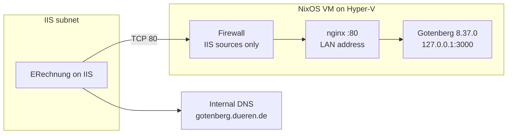

# Gotenberg on NixOS

LAN-only [Gotenberg](https://gotenberg.dev/) 8.37.0 for the ASP.NET ERechnung module on IIS. IIS uploads an invoice PDF and Factur-X / ZUGFeRD XML. Gotenberg embeds that XML, writes the Factur-X XMP metadata, and returns a PDF/A-3 (`POST /forms/pdfengines/factur-x`). The same VM can also turn HTML into a PDF with Chromium.

The VM is a NixOS Generation 2 guest on Windows Hyper-V. It is not published to the internet. nginx or Gotenberg binds the internal address, and the firewall accepts that port only from the IIS ranges in [`hosts/gotenberg/site.nix`](hosts/gotenberg/site.nix).

## License

Proprietary. All rights reserved. This repository is for internal use by Stadt Düren only. Do not add a `LICENSE` file; the maintainer is choosing one.

## Architecture

Phase 1 (the default) puts nginx on the LAN address, port 80. Gotenberg listens on `127.0.0.1:3000` inside Podman. A published container port on a non-loopback address would bypass the NixOS firewall, so the module never does that.



SSH is a separate path: TCP 22 from `adminSourceRanges` only, keys only.

Two other layouts, both still source-filtered:

| Layout | `site.nix` | Who faces the LAN | Base URL |
| --- | --- | --- | --- |
| Phase 1, proxy | `httpProxy = true`, `tls.enable = false` | nginx on port 80 | `http://gotenberg.dueren.de` |
| Phase 1, direct | `httpProxy = false` | Gotenberg on the host network, port 3000 | `http://gotenberg.dueren.de:3000` |
| Phase 2 | `httpProxy = true`, `tls.enable = true` | nginx TLS 1.2+ on 443, HTTP 308 to HTTPS | `https://gotenberg.dueren.de` |

Phase 2 keeps Gotenberg on loopback HTTP. The certificate stays in `/var/lib/secrets` and is never a Nix store path. See [docs/tls.md](docs/tls.md).

`downloadFrom` is off, so Gotenberg does not fetch remote URLs for a caller. There is no application password. The firewall is the access control.

## Pinned versions

| Piece | Version | Source |
| --- | --- | --- |
| NixOS | 26.05 “Yarara”, `nixos-26.05.11767.7993f34ee47e` | Channel [nixos-26.05](https://channels.nixos.org/nixos-26.05), git [`7993f34ee47e28a3d607a525aadc6c94b73be728`](https://github.com/NixOS/nixpkgs/commit/7993f34ee47e28a3d607a525aadc6c94b73be728), 2026-10-13 |
| Installer ISO | `nixos-minimal-26.05.11767.7993f34ee47e-x86_64-linux.iso` | SHA-256 `9d29b516f47eabf28ce6d17356a00f15daf3c1a267bbe1357d11a6d82dbe1090`, 1739718656 bytes |
| Gotenberg | **8.37.0** | [Release v8.37.0](https://github.com/gotenberg/gotenberg/releases/tag/v8.37.0) (2026-09-11) |
| Image | `docker.io/gotenberg/gotenberg:8.37.0` | linux/amd64 `sha256:3fdee07e0dcd5005c3db4d81d1600d081fc6fb424da87e409e1c1f9624a249b8` |

Factur-X form fields (`facturxXml`, `facturxConformanceLevel`) shipped in [v8.34.0](https://github.com/gotenberg/gotenberg/releases/tag/v8.34.0) (2026-06-12). The multi-arch index for 8.37.0 is `sha256:f29984bd1e226bf1b93ba90af06000afa8b315853e99d27b9aaa41b93f15c769`. The module pins the amd64 manifest because the Hyper-V VM is x86_64.

`flake.lock` records the Nixpkgs revision. `system.autoUpgrade` advances it along `nixos-26.05`.

## Configuration via site.nix

[`hosts/gotenberg/site.nix`](hosts/gotenberg/site.nix) is the only file for host-specific data. Everything else reads it. The copy in git is a placeholder. Replace the values in the checkout you install. Do not push a real address plan, a real key over the placeholder, or a password hash to a shared remote.

| Attribute | Placeholder | Meaning |
| --- | --- | --- |
| `fqdn` | `gotenberg.dueren.de` | Hostname, nginx `server_name`, and the base URL |
| `interface` | `eth0` | Hyper-V NIC. Predictable names are off |
| `useStaticAddress` | `true` | `false` plus `listenAddress = "0.0.0.0"` is the DHCP-reservation layout |
| `address` | `10.0.10.20` | Static IPv4. `CHANGE_ME` |
| `prefixLength` | `24` | |
| `gateway` | `10.0.10.1` | `CHANGE_ME` |
| `nameservers` | `10.0.10.1` | Internal DNS. `CHANGE_ME` |
| `listenAddress` | `null` | `null` uses `address` |
| `iisSourceRanges` | `10.0.20.0/24` | IIS servers allowed to call the API. `CHANGE_ME` |
| `adminSourceRanges` | `10.0.10.0/24` | SSH clients. `CHANGE_ME` |
| `adminUser` | `admin` | Wheel user, passwordless sudo |
| `adminAuthorizedKeys` | key ending in `REPLACE_ME` | Your ed25519 public key. The installer refuses to run while that marker is inside this list |
| `initialHashedPassword` | `null` | Console only. `null` locks it. SSH never accepts a password |
| `timeZone` | `Europe/Berlin` | |
| `consoleKeyMap` | `de` | |
| `apiPort` | `3000` | Loopback publish in proxy mode, or the LAN port in direct mode |
| `httpProxy` | `true` | `false` is direct mode |
| `tls.enable` | `false` | Phase 2. Certificate files must already be on disk |

Create the DNS name on internal DNS only. Do not publish it in the public zone:

```text
gotenberg.dueren.de.   300   IN A   10.0.10.20
```

Use the address from `site.nix`. `dueren.de` is also a public name, so internal clients need split-horizon DNS. `gotenberg.intern.dueren.de` needs its own internal zone and does not match a one-label `*.dueren.de` certificate. Details are in [docs/hyperv-setup.md](docs/hyperv-setup.md).

Generate the admin key on a workstation:

```bash
ssh-keygen -t ed25519 -C "gotenberg-admin"
```

Paste the `.pub` line into `adminAuthorizedKeys` and delete the `REPLACE_ME` line. An optional console password:

```bash
nix-shell -p mkpasswd --run 'mkpasswd -m sha-512'
```

To reuse the module on another NixOS host, import `nixosModules.gotenberg-lan`. [`examples/configuration.nix`](examples/configuration.nix) is that import. This repo’s bootable output is `nixosConfigurations.gotenberg`.

## Install on Hyper-V

The long click-path, the ISO URL, and the temporary installer address are in [docs/hyperv-setup.md](docs/hyperv-setup.md). The short path:

1. Clone the repo on a workstation and edit `hosts/gotenberg/site.nix`.
2. Add the internal DNS A record. Do not publish it.
3. Download the minimal ISO and check the SHA-256 in the table above. `scripts/hyperv-create-vm.ps1 -DownloadIso` does both.
4. Create an **external** virtual switch on the physical LAN adapter. The Hyper-V “Default Switch” is NAT and is the wrong network.

```powershell
New-VMSwitch -Name "LAN" -NetAdapterName "Ethernet" -AllowManagementOS $true
```

5. Create a Generation 2 VM: Secure Boot off, 2 vCPU, 4 GB fixed (dynamic memory off), 40 GB VHDX, that switch, production checkpoints, automatic start. From an elevated PowerShell session in the clone:

```powershell
.\scripts\hyperv-create-vm.ps1 -SwitchName "LAN" -IsoPath $iso
```

6. Boot the ISO. `loadkeys de` if the console keyboard is German. Confirm the virtual disk with `lsblk` (usually `/dev/sda`, not the ISO). The installer needs HTTPS to GitHub, `cache.nixos.org`, and `registry-1.docker.io`. DHCP on the installer is enough; the installed system then uses the static address. Clone the edited repo (or copy `site.nix` onto the ISO) and install:

```bash
CONFIRM=yes DISK=/dev/sda REPO=/root/gotenberg-nixos \
  bash /root/gotenberg-nixos/scripts/install-from-iso.sh
```

The script refuses a disk that has any mounted partition, refuses a key that still says `REPLACE_ME`, writes a 512 MiB ESP (`NIXBOOT`) and an ext4 root (`NIXROOT`), copies the repo to `/mnt/etc/nixos`, and runs `nixos-install --flake /mnt/etc/nixos#gotenberg`.

7. Shut the VM down, remove the ISO, and start it:

```powershell
Stop-VM -Name gotenberg -Force
Get-VMDvdDrive -VMName gotenberg | Remove-VMDvdDrive
Start-VM -Name gotenberg
ssh -i $env:USERPROFILE\.ssh\id_ed25519 admin@10.0.10.20
```

There is no root password. SSH is key-only. The first `gotenberg` start stays in `activating` until Podman has pulled the image and `/health` succeeds. `journalctl -u gotenberg -e` shows that pull.

`virtualisation.hypervGuest.enable` loads `hv_vmbus`, `hv_storvsc`, `hv_netvsc`, `hv_utils`, and `hv_balloon`, and starts the guest daemons production checkpoints use.

## API

Call these from a host in `iisSourceRanges`. Phase 1 proxy URLs are shown. Direct mode uses `http://gotenberg.dueren.de:3000`. Phase 2 uses `https://gotenberg.dueren.de`. There is no trailing slash on the base URL. A source outside the IIS list gets no TCP handshake.

Gotenberg does not Schematron-validate the XML. It records `facturxConformanceLevel` in the XMP metadata and converts the PDF to PDF/A-3. This deployment’s callers send `EN 16931` or `XRECHNUNG` only.

### Health

`GET /health` returns HTTP 200 and `{"status":"up"}` when the API is up.

```bash
curl --fail --silent --show-error http://gotenberg.dueren.de/health
```

On the VM, before DNS is delegated, `/etc/hosts` already maps the static address:

```bash
curl --fail --silent --show-error http://127.0.0.1:3000/health
sudo podman inspect --format '{{.State.Health.Status}}' gotenberg
```

`scripts/check-health.sh` is the same curl. The default argument is `http://127.0.0.1:3000/health`.

### Chromium HTML to PDF

`POST /forms/chromium/convert/html`. The HTML part must be named `index.html`. Other names return HTTP 400 (`form file 'index.html' is required`).

```bash
curl --fail --show-error \
  --request POST \
  --form files=@index.html \
  --output invoice.pdf \
  http://gotenberg.dueren.de/forms/chromium/convert/html
```

Assets uploaded in the same request are referenced by filename only, not by a path.

### Factur-X

`POST /forms/pdfengines/factur-x`. `files` is the invoice PDF. `facturxXml` is the CII XML (embedded as `factur-x.xml` whatever the local filename is). `facturxConformanceLevel` is `EN 16931` or `XRECHNUNG`. Quote the value: it contains a space in `EN 16931`.

EN 16931:

```bash
curl --fail --show-error \
  --request POST \
  --form files=@invoice.pdf \
  --form facturxXml=@factur-x.xml \
  --form 'facturxConformanceLevel=EN 16931' \
  --output invoice-facturx.pdf \
  http://gotenberg.dueren.de/forms/pdfengines/factur-x
```

XRechnung:

```bash
curl --fail --show-error \
  --request POST \
  --form files=@invoice.pdf \
  --form facturxXml=@factur-x.xml \
  --form facturxConformanceLevel=XRECHNUNG \
  --output invoice-xrechnung.pdf \
  http://gotenberg.dueren.de/forms/pdfengines/factur-x
```

The response body is the PDF. The API timeout is 120 seconds and the multipart limit is 64 MB.

## Base URL for the ERechnung app

Set this in `appsettings.Production.json` on IIS. No trailing slash. The client appends `/forms/pdfengines/factur-x`. Set the `HttpClient` timeout above 120 seconds (150 seconds is a reasonable start).

The JSON property has to match the ERechnung options class. The environment-variable form of the example is `ERechnung__GotenbergBaseUrl`.

Phase 1, proxy (this host’s default):

```json
{
  "ERechnung": {
    "GotenbergBaseUrl": "http://gotenberg.dueren.de"
  }
}
```

Phase 1, direct (`httpProxy = false`):

```json
{
  "ERechnung": {
    "GotenbergBaseUrl": "http://gotenberg.dueren.de:3000"
  }
}
```

Phase 2, after the wildcard certificate is installed:

```json
{
  "ERechnung": {
    "GotenbergBaseUrl": "https://gotenberg.dueren.de"
  }
}
```

A public `*.dueren.de` certificate needs no extra trust on Windows. An internal CA must be imported into `Cert:\LocalMachine\Root` on each IIS server. See [docs/tls.md](docs/tls.md).

## Updating and rollback

The running configuration is the Git checkout at `/etc/nixos`. Rebuilds use the `gotenberg` flake output. [docs/operations.md](docs/operations.md) is the full runbook, including the digest lookup and Hyper-V checkpoints.

NixOS along `nixos-26.05` updates itself daily at about 02:15. A reboot is allowed only between 01:00 and 05:00, and only when the kernel or initrd changes. By hand:

```bash
cd /etc/nixos
sudo nix flake update nixpkgs
sudo nixos-rebuild switch --flake /etc/nixos#gotenberg
```

Gotenberg upgrades are a new `image.tag` and `image.digest` in `modules/gotenberg-lan.nix`, then the same `nixos-rebuild switch`. Take a production checkpoint first. Podman keeps the previous image until `podman system prune -f --all --filter until=336h` (Sundays at 05:40, or run it by hand). `nix.gc` does not delete OCI images. Garbage collection on Sundays at 05:30 deletes store paths older than 14 days.

Roll back the NixOS generation:

```bash
sudo nixos-rebuild switch --rollback
```

The systemd-boot menu (`Esc` or space on the Hyper-V console) boots an older generation once. `--rollback` makes it the default. A generation rollback does not restore PEM files or a disk from before a checkpoint. Restore a checkpoint only when the generation rollback is not enough; it discards every disk write since the checkpoint.

```powershell
Checkpoint-VM -Name gotenberg -SnapshotName "before-upgrade"
Restore-VMCheckpoint -Name "before-upgrade" -VMName gotenberg -Confirm:$false
Start-VM -Name gotenberg
```

## Troubleshooting

| Symptom | What to check |
| --- | --- |
| Installer says the SSH key still contains `REPLACE_ME` | Replace the line inside `adminAuthorizedKeys` only. A comment outside that list is ignored |
| Installer refuses to partition | A partition of that disk is mounted, including a by-uuid mount. `lsblk` and pick the empty virtual disk, not the ISO |
| `gotenberg` stays `activating` | First image pull, or `/health` failing. `journalctl -u gotenberg -e`. Outbound HTTPS to `registry-1.docker.io` is required |
| `curl` to the FQDN works on the VM and fails on IIS | Split DNS. `/etc/hosts` on the VM is not the internal zone. Publish the A record only on internal DNS |
| IIS times out, no handshake | Source is outside `iisSourceRanges`, the VM is on the Default Switch, or the client uses port 3000 while phase 1 listens on 80 |
| HTTP 400 on HTML conversion | The uploaded file is not named `index.html` |
| HTTP 413 | Multipart body is over 64 MB. Raise `bodyLimit` in the module and the nginx limit follows |
| HTTP 503 or a client timeout around 120 seconds | The API timeout is 120 seconds. Raise `timeouts.api` and the HttpClient timeout together |
| nginx will not start in phase 2 | Certificate or key missing, wrong mode, or a path under `/nix/store`. See [docs/tls.md](docs/tls.md) |
| Clock jumps | Hyper-V time sync and timesyncd both stepping. Disable the Hyper-V “Time Synchronization” integration service and keep timesyncd |
| `autoUpgrade` does nothing | The timer needs outbound HTTPS to GitHub and `cache.nixos.org`. `systemctl status nixos-upgrade.service` |
| Disk fills up after image upgrades | `sudo podman system prune -f --all --filter until=336h`. The running image is kept |
| `nix flake check` warns about `REPLACE_ME` | Expected on the placeholder key in git. The installed host should not warn |

Evaluation of this flake warns while `adminAuthorizedKeys` still contains `REPLACE_ME`. That warning is the reminder, not a failed check.

## Layout

| Path | Role |
| --- | --- |
| `modules/gotenberg-lan.nix` | `services.gotenberg-lan` on `virtualisation.oci-containers` |
| `hosts/gotenberg/` | Hyper-V guest: networking, SSH, firewall, auto-upgrade, GC, Podman prune, Gotenberg |
| `examples/configuration.nix` | Import the module into an existing NixOS host |
| `scripts/hyperv-create-vm.ps1` | Generation 2 VM, Secure Boot off, ISO checksum |
| `scripts/install-from-iso.sh` | GPT + UEFI install of this flake |
| `scripts/check-health.sh` | `curl` wrapper for `/health` |
| `docs/hyperv-setup.md` | ISO, switch, install, first boot, DNS |
| `docs/tls.md` | Phase 2 wildcard certificate |
| `docs/operations.md` | Upgrade, rollback, checkpoint, `/health` |
| `AGENTS.md` | Rules for coding agents |
| `.github/workflows/ci.yml` | `nix fmt`, `nix flake check`, NixOS build |

## Development

```bash
nix fmt
nix flake check
nix build .#nixosConfigurations.gotenberg.config.system.build.toplevel
```

`nix fmt` is nixfmt 1.5 (RFC 166) via the flake `formatter` output. See [CONTRIBUTING.md](CONTRIBUTING.md) and [AGENTS.md](AGENTS.md).
